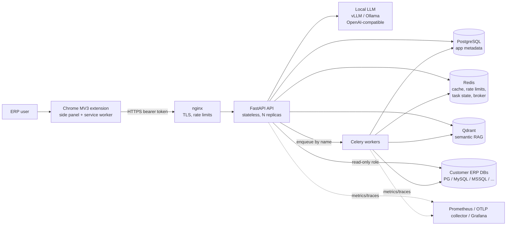

# ERP Insight AI — Architecture

Status: **Phases 1–3 implemented** (foundation; authentication, tenancy/RBAC, connections,
PostgreSQL + SQLite adapters, metadata discovery; semantic layer, Qdrant hybrid RAG, LLM
provider layer). Later sections describe the target design for Phases 4–7. Anything not yet built is marked *(Phase N)*.

## 1. Purpose and scope

ERP Insight AI lets authorized ERP users ask analytical questions in plain English
("Show total sales by region for the last six months") and get governed answers
(tables, KPIs, charts, explanations) from one or more connected ERP databases.

**In scope (MVP):** read-only analytics over PostgreSQL, MySQL/MariaDB, SQL Server and
SQLite, with foundations for Oracle, SAP HANA, Snowflake and BigQuery; local LLMs by
default; multi-tenant SaaS or single-tenant on-prem deployment.

**Explicitly out of scope:** any write to ERP systems (INSERT/UPDATE/DELETE/DDL/DCL,
stored procedures). A future "approved action workflow" would be a separate, separately
authorized subsystem.

## 2. Guiding principles

1. **Semantic query plan, not text-to-SQL.** The LLM emits a database-independent
   `QueryPlan` (entity, dimensions, measures, filters, date range, sort, limit).
   Deterministic code validates, authorizes and compiles it. This decouples the product
   from any single SQL dialect or model, and makes safety checkable.
2. **Defense in depth for read-only access** (see §7.4) — no single control is trusted.
3. **Deterministic over autonomous.** The agent is a finite state machine with bounded
   steps and timeouts; tools are an explicit allow-list with typed I/O.
4. **Tenant scope everywhere** — SQL, cache keys, vector filters, logs, metrics labels (never).
5. **The browser is untrusted.** No credentials, no SQL, no business rules in the extension.
6. **Aggregate by default** — large ERP datasets are queried via reporting views,
   server-side aggregation, pagination and limits; row-level exports are explicit and async.

## 3. System context



### Components

| Component | Tech | Responsibility | Scaling |
|---|---|---|---|
| Browser extension | Angular 22, MV3, ECharts | Side-panel UI; background worker owns tokens, API calls, WebSocket, message routing | per user |
| nginx | nginx 1.30 | TLS termination, coarse per-IP rate limits, blocks `/metrics` & `/docs` publicly, SSE/WebSocket proxying, safe access logs | 1–2 |
| API | FastAPI, Pydantic v2, SQLAlchemy 2 async | AuthN/Z, connections, metadata, analytics orchestration, history, feedback, audit | horizontal (stateless) |
| Worker | Celery (Redis broker) | Metadata sync, RAG ingestion, long queries, async exports, scheduled jobs | horizontal, per queue |
| App DB | PostgreSQL 18 | Tenants, users, RBAC, connections (secret refs only), history, feedback, audit | vertical + replicas |
| Redis | Redis 8 | Result/metadata/retrieval caches, rate limiting, short-lived task state, broker | vertical / managed |
| Qdrant | Qdrant 1.19 | Hybrid (dense + sparse) retrieval over semantic layer, glossary, examples, metadata, feedback | horizontal (sharding) |
| LLM serving | vLLM (GPU) / Ollama (CPU dev) / mock | Structured-JSON generation; embeddings; reranking | GPU nodes |
| Events | `EventBus` abstraction, NATS impl *(Phase 6)* | Domain events (query completed, sync finished) | — |
| Observability | Prometheus, Grafana, OpenTelemetry (OTLP/HTTP) | Metrics, dashboards, traces | — |

## 4. Question → answer flow *(implemented, Phases 4–5)*

The orchestrator (`app/agents/orchestrator.py`) is a finite state machine:

```
RECEIVE_QUESTION → CLASSIFY_INTENT → RESOLVE_DATA_SOURCE → DETECT_ANALYSIS_INTENT
  ├─ business analysis ("lead analysis for X"):
  │    RESOLVE_ENTITIES → RUN_ANALYSIS (governed sub-queries) ─────────────┐
  └─ RETRIEVE_SEMANTIC_CONTEXT → RETRIEVE_SIMILAR_EXAMPLES → BUILD_QUERY_PLAN │
     → SELECT_FIELDS → VALIDATE_QUERY_PLAN → [REQUEST_CLARIFICATION_IF_NEEDED] │
     → COMPILE_DIALECT_SQL → VALIDATE_SQL → ESTIMATE_COST                      │
     → EXECUTE_READONLY_QUERY → FORMAT_RESULT ─────────────────────────────────┤
→ VALIDATE_RESULT → GENERATE_EXPLANATION → STORE_AUDIT_EVENT → COMPLETE  ◄────┘
```

(Section 21 describes the validation-first steps: analysis intent, entity resolution,
field selection and result/chart validation.)

- Only registered tools are callable (`get_current_user_context`, `list_allowed_connections`,
  `retrieve_semantic_entities`, `retrieve_business_glossary`, `retrieve_similar_questions`,
  `build_query_plan`, `validate_query_plan`, `compile_sql`, `estimate_query_cost`,
  `execute_readonly_query`, `format_result`, `request_clarification`). No generic DB tool.
- The model contributes exactly three typed artefacts (intent, `QueryPlan`, explanation);
  it never chooses the next state. The only loop is **one** plan-correction pass
  (VALIDATE_QUERY_PLAN → BUILD_QUERY_PLAN) for *retryable* issues; policy blocks
  (forbidden/sensitive fields, unpermitted entities) are never retried with the model.
- Limits (`app/agents/policies.py`): max steps (`MAX_AGENT_STEPS`, floor 22 so the
  correction path and the validation-first steps fit), per-step timeout (`AGENT_STEP_TIMEOUT_SECONDS`, 45 s), total
  timeout (`AGENT_TOTAL_TIMEOUT_SECONDS`, 120 s); the execution state gets
  2 × `MAX_QUERY_SECONDS`, on top of the connector's own statement timeout and row cap.
  LLM retry/backoff lives in the provider (Phase 3); circuit breakers arrive in Phase 6.
- Every request carries a correlation ID (`X-Request-ID`) and optional `Idempotency-Key`
  (per tenant + user, 24 h). Cancellation (`POST /analytics/query/{id}/cancel`) trips the
  run's event (the current state is abandoned immediately), interrupts the running
  database statement, and sets a Redis flag so the API process that owns the run
  cancels it too. Every terminal state - including cancel and failure - still runs
  STORE_AUDIT_EVENT and updates `query_history`.
- Progress events reach the extension over a multiplexed WebSocket
  (`/api/v1/analytics/ws`, Phase 5; the background worker owns it) and, for other
  clients, over SSE (`POST /analytics/query/stream`). Both: `accepted` → `progress`* →
  `result` | `error`. A client disconnect cancels the run. If the WebSocket cannot be
  established, the extension falls back to plain HTTP (answer without live progress).
  See section 16 for the query engine and section 17 for the extension.

## 5. Data architecture

### 5.1 Application metadata DB (implemented, migrations `0001`–`0006`)

| Table | Notes |
|---|---|
| `tenants` | slug, status (`active`/`suspended`), settings JSONB |
| `users` | per-tenant unique email; Argon2id hash (Phase 2) or SSO subject; lockout fields |
| `roles`, `permissions`, `role_permissions` | static RBAC catalog seeded by the migration (mirrors `app/core/permissions.py`, drift-tested) |
| `user_roles` | user ↔ role within a tenant |
| `refresh_tokens` | SHA-256 hash only; `family_id` for rotation + reuse detection |
| `db_connections` | connector type, host/port/db/schema/username, **`secret_ref`** (never a password), TLS mode (default `verify-full`), pool sizes, timeout, max rows, optional `read_replica_host`/`read_replica_port` (`0006`); **`CHECK (read_only = true)`** |
| `connection_grants` | which roles may use a connection (connection-level authorization) |
| `metadata_snapshots` | versioned metadata syncs per connection (status, counts, added/changed/removed) — migration `0002` |
| `metadata_objects` | structure-only definition + SHA-256 fingerprint per table/view per snapshot — migration `0002` |
| `semantic_versions` | semantic-index builds per connection (status, content hash, embedding model/dims, document counts, entity bindings); one `active` per connection (partial unique index) — migration `0003` |
| `encrypted_secrets` | ciphertext for `local://` secret refs (envelope encryption, Phase 2) |
| `query_history` | question, validated plan, plan hash, SQL hash (no literal values), row count, timings, status (`pending`/`running`/`succeeded`/`planned`/`clarification`/`refused`/`failed`/`cancelled`, migration `0004`), error code, `Idempotency-Key` (unique per tenant + user, `0004`) — **no result rows** |
| `feedback` | rating ±1, categories, comment, linked to a query; one row per user and query (unique index, `updated_at`, migration `0005`) |
| `export_jobs` | background exports (`0006`): owner, query, format, scope, status (`pending`/`running`/`succeeded`/`failed`/`expired`/`cancelled`), row count, size, SHA-256, truncated flag, random storage key, `expires_at`, `downloaded_at` — the file itself lives in `EXPORT_DIR`, never in the database |
| `audit_events` | append-only (PostgreSQL trigger rejects UPDATE/DELETE/TRUNCATE); redacted details |

All tenant-owned rows carry `tenant_id` (indexed) and every repository query filters on
the tenant from the authenticated context (tested in `tests/security`). PostgreSQL
row-level security as a *second* barrier is deferred to Phase 7 hardening: it needs a
non-owner runtime role and per-transaction `SET LOCAL app.tenant_id`, and login/refresh
look-ups must happen before a tenant is known. Connection names are unique among live
rows via a partial unique index (`deleted_at IS NULL`).

### 5.2 Redis keyspace *(Phases 2–6)*

`rl:{tenant}:{user}:{window}` rate limits · `sess:{user}:{jti}` session state ·
`meta:{tenant}:{conn}:{version}:…` metadata cache ·
`rag:{tenant}:{conn}:{perm_hash}:{sem_version}:{query_hash}` retrieval cache ·
`qr:{tenant}:{conn}:{config_version}:v{sem_version}:{scope_hash}:{plan_hash}:{sql_hash}` query-result cache (Phase 6) ·
`export:dl:{sha256(token)}` one-time export download tokens (120 s) ·
`task:{id}` progress · `analytics:result:{tenant}:{user}:{query}` last response for
`GET /analytics/query/{id}` (TTL `QUERY_RESULT_TTL_SECONDS`, 15 min; 0 disables) ·
`analytics:cancel:{query}` cross-process cancel flag. Retrieval-cache entries of a
connection are invalidated (`SCAN rag:{tenant}:{conn}:*`) when its feedback memory
changes. **Every cache key includes tenant and authorization scope and has a TTL**
(`volatile-lru` eviction never touches broker keys).

### 5.3 Qdrant collections (implemented, Phase 3 — see `docs/semantic-layer.md`, `docs/local-llm.md`)

`semantic_entities`, `business_glossary`, `query_examples`, `database_metadata`,
`query_feedback`. Payload: `tenant_id`, `connection_id`, `document_type`, `entity_name`,
`permissions`, `version`. Payload indexes on those fields; every search has a mandatory
filter on tenant + permissions + active version (enforced in `rag/qdrant_client.py`, not by callers).

## 6. Deployment modes

| Mode | How | Notes |
|---|---|---|
| Local dev | `infrastructure/docker/docker-compose.yml` | CPU only; `LLM_PROVIDER=mock` or `--profile ollama`; dev ports bound to 127.0.0.1 |
| Single VM | base + `docker-compose.prod.yml` | TLS at nginx, internal data network, resource limits, log rotation, API/worker replicas |
| Kubernetes | `infrastructure/kubernetes/` (kustomize, Phase 7) | API/worker/scheduler Deployments + HPA/PDB, migrate Job, managed Postgres (and optionally Redis) recommended, Qdrant StatefulSet, optional vLLM on a GPU node pool, default-deny NetworkPolicies — `docs/deployment.md` |

Network segmentation (compose): `edge` (nginx, grafana) · `app` (API/worker/observability,
egress to customer ERP DBs) · `data` (Postgres/Redis/Qdrant; `internal: true` in production).

## 7. Security architecture

### 7.1 Authentication (implemented, Phase 2 — details in `docs/security.md`)
- Login takes `{tenant, email, password}`; Argon2id hashes; unknown accounts still pay
  the Argon2 cost; every failure returns the same `INVALID_CREDENTIALS`.
- Short-lived JWT access tokens (default 10 min, HS256/384/512 only) carrying `sub`,
  `tid`, `sid` (session = refresh family), `jti`, `iss`, `aud`, `typ`.
- Opaque refresh tokens (256-bit random), stored as SHA-256, **rotated on every use**,
  absolute session lifetime; presenting a revoked token revokes the whole family.
- Every request re-loads user, tenant and session state, so logout, deactivation,
  role changes and refresh-token reuse take effect immediately (no 10-minute window).
- Brute force: per-IP (nginx + Redis) and per-account (Redis) rate limits with
  `Retry-After`, plus exponential account lockout in the database (survives Redis loss).

### 7.2 Extension token strategy
- The side panel never sees tokens. The background service worker holds them in
  `chrome.storage.session` (memory-only, cleared on browser exit) with access level
  `TRUSTED_CONTEXTS` (content scripts cannot read it). No content scripts are injected.
- API calls are bearer-authenticated (`credentials: 'omit'`, no cookies → no CSRF surface);
  CORS allows only configured `chrome-extension://<id>` origins, without credentials.
- Secure logout: revoke refresh family server-side, clear session storage.
- MV3 CSP `script-src 'self'; object-src 'self'`; build fails on inline scripts.

### 7.3 Authorization
- RBAC: `platform_admin`, `tenant_admin`, `data_admin`, `analyst`, `viewer` →
  permissions `connections.read|manage`, `metadata.read`, `analytics.query|export`,
  `history.read`, `feedback.write`, `admin.manage` (`app/core/permissions.py`).
- Tenant context bound once per request (`app/core/tenant_context.py`); services read it,
  never a tenant ID from the payload. Cross-tenant access → denial.
- Connection-level grants: users without `connections.manage` only see connections
  granted to one of their roles; invisible or foreign connections return 404.
- Admin API guards against privilege escalation (roles above the actor's rank and
  `platform_admin` cannot be granted; self-deactivation/self-demotion blocked).
- Permission-filtered retrieval: each indexed document lists the permissions its entity
  requires; retrieval excludes documents needing a permission the caller lacks, and the
  LLM vocabulary only contains bound entities the caller may use (Phase 3).

### 7.4 Read-only enforcement (defense in depth)
1. LLM output is a JSON plan, not SQL; no DB tool is exposed to the model.
2. Plan validator: approved entities/fields/joins only, sensitive fields forbidden,
   tenant predicates injected, date filters required on large facts, limits capped.
3. SQL compiled by SQLAlchemy from the plan — bound parameters only, no `SELECT *`.
4. SQL validator (AST-based, `sqlglot`): single `SELECT` statement, no comments, no
   DML/DDL/DCL, no unapproved objects, no dangerous functions, no system catalogs,
   no cartesian joins, complexity/cost thresholds.
5. Database session: read-only role (SELECT on reporting views only), server-side
   `default_transaction_read_only=on`, `statement_timeout` (the customer's read-only role; see `docs/connector-development.md`).
6. Stored connection config cannot be writable (`CHECK (read_only = true)`).
7. Audit record for every query; anomaly alerts on denied/failed patterns.

### 7.5 Secrets and outbound connections (implemented, Phase 2)
- `SecretStr` for all secrets in settings (never in `repr`/logs).
- Production refuses to start with default/short secrets, wildcard CORS, mock LLM,
  non-JSON logs, or SQLite connections enabled.
- ERP passwords are write-only: stored as AES-256-GCM ciphertext (`local://` refs, key
  derived with HKDF from `ENCRYPTION_KEY`, AAD = tenant + row + purpose) or referenced as
  tenant-prefixed environment secrets (`env://ERP_SECRET_<TENANT>_<NAME>`). Vault/cloud
  `vault://` references read HashiCorp Vault KV v2 (Phase 7); AWS/GCP/Azure secret
  managers remain reserved schemes. Encryption keys are versioned and rotatable.
- SSRF defence: connection hosts are checked (literal and DNS-resolved) against a
  denylist of loopback, link-local/metadata and platform service names; production TLS
  modes `disable`/`prefer` are refused; SQLite files are sandboxed to `SQLITE_DATA_DIR`.

### 7.6 Logging, errors and data minimisation (implemented)
- JSON logs with request/tenant/user IDs; recursive key-based redaction + pattern
  scrubbing of DSN passwords, bearer tokens, JWTs, `password=`/`api_key:` pairs on every
  record, including exception text. Uvicorn access log disabled; nginx logs `$uri` (no query string).
- Uniform error envelope; stack traces and exception text never returned; validation
  errors never echo submitted values.
- Security headers on every API response; HSTS in production.
- Request IDs accepted from clients only if they match `^[A-Za-z0-9_-]{8,64}$`.

### 7.7 Prompt-injection defenses (implemented, Phase 3)
Retrieved metadata/comments/glossary are wrapped as quoted data with provenance, stripped
of instruction-like content at ingestion, never allowed to change tool availability, and
all model output is schema-validated and re-authorized. The model never sees credentials.

## 8. Observability (Phase 1 base implemented)
- Metrics (`/metrics`, internal only): `erp_http_requests_total{method,route,status}`,
  `erp_http_request_duration_seconds`, `erp_http_requests_in_progress`,
  `erp_dependency_up`, `erp_dependency_check_duration_seconds`, `erp_app_info`.
  Phases 2-3 added connector operations/latency, LLM latency/tokens/validation failures,
  embedding/retrieval latency, cache hit/miss and ingestion metrics. Phase 4 adds
  `erp_analytics_queries_total{mode,status}`, `erp_analytics_query_duration_seconds`,
  `erp_agent_step_duration_seconds{step,status}` and
  `erp_sql_safety_rejections_total{reason}` (a compiled statement failing the
  independent SQL check is a compiler/policy defect and must alert). Phase 5 adds
  `erp_ws_connections`, `erp_ws_messages_total{type,outcome}`,
  `erp_feedback_submissions_total{rating}` and
  `erp_feedback_memory_updates_total{action,outcome}`. Phase 6 adds
  `erp_export_jobs_total{event}`, `erp_export_rows_total`,
  `erp_cache_requests_total{cache="query_result"|"catalog"}`, and circuit-breaker /
  queue rejections as `erp_connector_operations_total{operation="breaker"|"queue"}`.
- Tracing: OpenTelemetry server spans per request (W3C `traceparent` propagated),
  OTLP/HTTP export when `OTEL_ENABLED=true`. Span attributes never contain SQL values,
  prompts or rows.
- Grafana dashboard `ERP Insight AI - API overview` is provisioned automatically.
- Health: `/health/live` (process only), `/health/ready` (Postgres, Redis, Qdrant with
  per-check timeouts; 503 if a required check fails; error text never exposed).

## 9. Performance model (implemented in Phase 6; details in `docs/performance.md`)
Cached metadata < 100 ms · cached common question < 500 ms · normal analytical query
< 5 s (DB permitting) · extension first response < 300 ms · progress events < 1 s.
Levers: reporting/materialized views, partition-aware date filters, connection pools per
connection, per-connection concurrency limits, server-side cursors and streamed batches
(never full result sets in memory), Redis caches keyed by normalized plan + scope,
async exports with expiry, circuit breakers for unhealthy databases, read replicas,
per-tenant and per-user rate limits. Budgets are enforced by `tests/performance`.

## 10. Assumptions

1. **Monorepo root** is `erp-insight-ai/` inside the working directory; Git initialised, no remote.
2. **Python 3.12** and pip/venv (no Poetry/uv required); one venv (`apps/api/.venv`) serves API and worker.
3. **Celery** (not Dramatiq) for background jobs: mature routing, time limits, beat scheduler, ops tooling.
   Redis is the broker in all modes; a dedicated broker (RabbitMQ) can be swapped via `CELERY_BROKER_URL`.
4. **Events:** an `EventBus` protocol with a NATS implementation (Phase 6); Kafka can implement the same protocol.
5. **App metadata DB** is PostgreSQL. Models are written portably so unit tests run on SQLite;
   PostgreSQL-specific behaviour is covered by integration tests.
6. **No demo data ships.** The product connects to live ERP databases; the semantic
   layer (`semantic-layer/`, customer-owned) starts empty and is drafted from the live
   metadata (`onboard draft`) and reviewed. The demo ERP, its semantic layer and the
   labelled questions are test fixtures under `apps/api/tests/fixtures/`.
7. **Customers provision** a read-only DB role and, for large ERPs, reporting views or a
   warehouse/replica. Querying raw transactional tables at scale is not supported.
8. **Single-region** deployment; data residency handled by per-region deployments.
9. **Authentication** is first-party username/password + JWT for the MVP; OIDC/SAML SSO
   plugs into the same principal model later (`users.external_subject`).
10. **LLM:** any model served through an OpenAI-compatible API that reliably emits JSON
    (vLLM guided decoding / Ollama `format`). The model name is configuration only.
11. **Extension distribution** via Chrome Web Store or enterprise policy with a fixed
    extension ID, which is what CORS allow-lists.
12. **Node.js** `^22.22.3 || >=24.15` is required by Angular 22.
13. **"Today"** for relative periods is the tenant's local date (`tenants.settings.timezone`,
    IANA name; UTC otherwise). Periods resolve to half-open `[start, end)` date windows;
    "this month/quarter/year" end today (inclusive), "last N days" includes today.
14. **Large fact entities** without a date filter get the default period *last 90 days*,
    and the response lists that as an assumption (instead of refusing the question).
15. **Joins** are single-hop, approved `many_to_one`/`one_to_one` joins from the main entity
    (at most 2 per plan); measures come only from the main entity. This keeps aggregates
    free of fan-out double counting. Multi-hop paths need a reporting view.
16. **Comparisons** run as two statements (current and previous window) with identical
    shape, merged in the formatter (`_previous`, `_change`, `_change_pct` columns).
17. **Time buckets** are returned as the bucket's first day (`2026-04-01` for Q2) on every
    dialect: PostgreSQL `date_trunc`, SQLite `strftime`/`printf`, MySQL `DATE`/`SUBDATE`/
    `DATE_FORMAT`, SQL Server `DATEFROMPARTS`/`DATEADD`, Oracle `TRUNC`. Weeks start on
    Monday (ISO). SAP HANA (foundation) supports day/month/year only.
18. **Responses are not persisted with rows**: `query_history` keeps hashes and counts; the
    full response (incl. rows) lives only in Redis for `QUERY_RESULT_TTL_SECONDS`.
    An idempotent replay after that TTL returns the stored status/plan without rows.
19. **Only the query's owner** can read, follow up on, cancel, save or delete it; history
    is personal. Tenant admins (`admin.manage`) can list the tenant's *feedback*
    (`GET /feedback?scope=tenant`) to review answer quality, not other users' results.
20. **The explanation model** receives the plan description, assumptions and at most 20
    aggregated result rows (sensitive fields cannot be selected, so they never reach it);
    if it fails, a deterministic summary is returned (`explanation.source = "system"`).
21. **Feedback memory is tenant-shared per connection.** A thumbs-up on a succeeded answer
    turns its question + plan *structure* (no filter values) into a retrieval example for
    everyone in the tenant who may query that entity on that connection. It is the
    "error correction and query feedback memory" of the specification; disable it with
    `FEEDBACK_MEMORY_ENABLED=false`. A thumbs-down or deleting the query removes it.
22. **Conversation state stays in the side panel's memory** (never in extension storage,
    because answers contain business data); server-side history keeps questions and
    hashes, and answers only for `QUERY_RESULT_TTL_SECONDS`.
23. **Two export paths.** Client-side CSV/JSON of the rows already shown (Phase 5), and
    Phase 6 *background* exports that re-run the stored plan on the server - `result`
    (same rows) or `all_rows` (without the interactive cap, up to `EXPORT_MAX_ROWS`).
    Both need `analytics.export` and an explicit confirmation.
24. **Currency values are shown without a symbol**: the API does not yet carry a column's
    currency code, and guessing one would mislead.
25. **MySQL and SQL Server are GA; Oracle and SAP HANA are foundations** (disabled unless
    `ENABLE_FOUNDATION_CONNECTORS=true`) because they have not been run against a live
    server. Snowflake/BigQuery are documented stubs (`CONNECTOR_NOT_SUPPORTED`).
26. **MySQL driver is aiomysql** (pure Python, MariaDB compatible) rather than asyncmy
    (needs a compiler on some platforms). **SQL Server uses aioodbc + Microsoft ODBC
    Driver 18**, installed in the images; the driver name is configurable.
27. **Result-cache sharing is by scope, not by user**: users with identical permissions
    and row-filter values share cached answers (they would get identical rows anyway);
    anything else is a different key. The cache is on by default with a 5-minute TTL.
28. **The circuit breaker and concurrency limit are per API/worker process** (in memory).
    They protect each process's pool; a cluster-wide limit is `replicas × pool_max_size`.
29. **Export files are stored on a local/shared volume** (`EXPORT_DIR`) with a 1-hour TTL,
    served by the API through one-time tokens; object storage with presigned URLs is a
    later option. The download token is bearer-less by design (browser download managers
    cannot send headers), so it is single-use, 120 s, hashed at rest and kept out of logs.
30. **Sensitive-data scan** for exports detects payment-card numbers (Luhn) and IBANs
    (mod-97) in string cells and aborts the whole export instead of masking, because a
    semantic layer that exposes such values is a configuration error to fix, not to hide.
31. **Exports re-authorize at run time** with the user's *current* roles and the *current*
    semantic version; the original plan is re-resolved, never trusted.
32. **Held-out evaluation questions with gold plans.** The fixture question set is kept
    separate from `semantic-layer/examples` (which are few-shot context); result
    correctness compares with the gold plan's rows, not hand-written SQL.
33. **Safety refusals are deterministic.** The question guard refuses write statements
    and forbidden-field requests before any model call; the model is not trusted to
    refuse. Guard terms are derived from the semantic layer and the sensitive-field
    policy (whole-term matches only, to avoid false positives such as "Japan").
34. **Vault is the supported external secret manager**; tenant isolation is enforced by
    a per-tenant path prefix, and the platform only reads.
35. **Kubernetes base uses plain kustomize** (no Helm chart), expects managed PostgreSQL,
    ingress-nginx and a ReadWriteMany storage class.
36. **History is grouped by chat.** The side panel sends a `conversation_id` (new for
    each "New chat"); a follow-up without one joins its parent's chat, and questions from
    before migration 0007 are one-question chats. Saving or deleting a chat applies to
    every question in it (each delete is audited as before). The per-question history
    endpoints are unchanged.
37. **Answers read like a chat reply: one visual, then a short plain-language summary** -
    the chart, KPI cards for single-figure answers, or a plain table for lists that
    cannot be charted - with no Table / Query plan / Details tabs (chat and history
    alike). The summary (`answer-summary.ts`) is built deterministically from the result,
    not by a model: highest/lowest values, shares and totals (only from the server's
    "total" KPIs, i.e. additive measures), trend and peak over time, change against the
    previous period, and the date range covered. Shapes it cannot describe fall back to
    the model's explanation. The rows, plan and provenance remain in the response
    (export, follow-ups); "Plan only" answers still show the plan. "New chat" in the
    chat header starts a new conversation (and history entry).
38. **A successful connection test prepares the source** for data admins: sync tables,
    then build the index, skipping steps already current unless the source is new or its
    connection (type, host, port, database, schema, user) changed.
39. **A business name is resolved before any data is read** (section 21): exact match,
    then a normalized match (punctuation, "&"/"and", legal suffixes) only when no
    look-alike exists; anything else is a clarification with the candidates and their
    ids. Master entities that name a party (company, customer, supplier, ...) are
    searched before others, because campaigns or leads are often named after a company
    ("Pending Metals Co" is both company #2 and campaign #2 in the live data). A company
    is never silently replaced by another, or by "all companies".
40. **Field roles** (`category`, `name`, `identifier`, `free_text`, plus `time`) come from
    the semantic layer's `role`, else from the field name (`*_note`, `notes`,
    `description`, `requirement` → free text; `id`, `*_id` → identifier). Free text and
    identifiers are never chosen as a breakdown unless the question names them, and are
    never chart categories.
41. **Blank means missing**: NULL, empty, whitespace and placeholders (`null`, `n/a`,
    `none`, `-`, ...) are counted as missing, never shown as a "(blank)" category. A
    breakdown more than `RESULT_MAX_BLANK_RATIO` (default 0.5) missing is rejected; one
    with some missing values is shown with a separate note ("Source is missing for 10 of
    20 leads").
42. **The question's subject wins over the planner's guess**: when a question names an
    entity ("show *leads* by status") and the planner chose another (bids, which also
    have a status), the plan is rebuilt on the named entity - unless the planner's
    entity is joined to it and answers a "by <field>" the named one cannot ("number of
    leads by event type" stays on lead events).
43. **Counting the parent of a joined fact uses its distinct key**: "number of leads"
    over lead events uses a `count_distinct` measure of `leads_id` (12 events are 2
    leads); without such a measure the answer says it counts events. Count measures on
    the key are compiled as `COUNT(DISTINCT ...)` whenever joins are involved.
44. **Values are never substituted**: a requested value (lead value, amount, profit) that
    no measure provides is reported as unavailable - a clarification when nothing else
    requested exists, a note otherwise. A company's turnover or a product's price is not
    a lead's value.
45. **Business analyses are computed, not narrated**: totals, breakdowns, recency, trend,
    follow-ups, conversion and priority come from validated read-only sub-queries; each
    metric names its query; figures that cannot be computed are listed with the reason;
    the summary is built from those metrics only (`explanation.source = "system"`).
46. **Trace logging** (`app.analytics.trace`) records per request the intent, entity
    match, plan (and any re-targeting), every sub-query's SQL, row counts, dimension
    quality, the chart decision and metric keys. Question text, values and SQL parameters
    are only logged with `ANALYTICS_TRACE_VALUES=true` (default off: business data stays
    out of logs).

## 11. Security-sensitive decisions (ADR summary)

| # | Decision | Rationale |
|---|---|---|
| S1 | Bearer tokens in the extension background worker, `chrome.storage.session`, no cookies | Keeps tokens out of page contexts; avoids CSRF; tokens vanish on browser exit |
| S2 | Refresh token rotation with family revocation | Detects stolen refresh tokens |
| S3 | `read_only` enforced by DB constraint + read-only DB role + session read-only + SQL validator | Layered; any one failing is not sufficient to write |
| S4 | LLM returns plans, never SQL; no DB tool | Removes the largest injection surface |
| S5 | `audit_events` append-only via trigger | Tamper resistance even against application bugs |
| S6 | Production config guard (secrets, CORS, mock LLM, JSON logs) | Fail fast instead of running insecurely |
| S7 | Redaction in the log formatter, not at call sites | Cannot be forgotten by a developer |
| S8 | Errors never include internals; validation errors never echo input | Prevents info leakage / reflected payloads |
| S9 | `/metrics` and `/docs` blocked at nginx; docs disabled in production | Minimise reconnaissance surface |
| S10 | JSON-only Celery serialisation | No pickle deserialisation RCE via the broker |
| S11 | Data network internal in production; dev ports bound to 127.0.0.1 | Datastores unreachable from outside |
| S12 | External LLM providers disabled unless explicitly enabled | Prevents accidental data egress to third parties |
| S13 | Containers run as non-root (UID 10001); Redis dangerous commands disabled | Reduce blast radius |
| S14 | Deterministic question guard before any model call | Refusals must not depend on model behaviour (found by the eval harness) |
| S15 | Vault paths scoped per tenant; platform token read-only | A tenant's `vault://` reference cannot reach other tenants' or platform secrets |
| S16 | Kubernetes: restricted PSS, read-only root FS, no SA tokens, default-deny egress (no metadata endpoint) | Limits SSRF and container-escape blast radius |

## 12. Deviations from the original specification

| Spec | Implementation | Why |
|---|---|---|
| `apps/worker/app/…` | `apps/worker/erp_worker/…` | Worker imports API domain services; two top-level packages named `app` cannot coexist in one environment |
| `api/app/workers/tasks.py` holds tasks | holds the **producer-side** `TaskDispatcher`; task bodies live in `erp_worker/tasks/` | API and worker deploy/scale independently; API enqueues by task name only |
| Makefile | Makefile **delegates to `scripts/dev.py`** | Works on Windows without `make` |
| `/connections/{id}/entities` = semantic entities | In Phase 2 these are **discovered database objects** (tables/views) from the latest metadata snapshot | Semantic entities arrive in Phase 3 and will be layered on top |
| Semantic-layer endpoints unspecified | `/connections/{id}/semantic/{ingest,status,search,resolve}` | Operators need to build/inspect the index; `resolve` exercises retrieval + LLM + re-validation end to end before Phase 4 |
| RRF inside Qdrant | Deterministic **client-side** RRF over dense and sparse legs | Reproducible ranking, independent of the Qdrant version and of local/in-memory mode |
| Admin API unspecified | `GET/POST /api/v1/admin/users`, `PATCH /api/v1/admin/users/{id}` | Tenants need a way to manage users and roles |
| Separate files for middleware/metrics/tracing | added `core/middleware.py`, `core/metrics.py`, `core/tracing.py` | Single-responsibility modules |
| `/analytics/follow-up` body unspecified | `{question, parent_query_id, connection_id?}`; the parent's stored plan is the follow-up context | The server - not the client - owns the previous plan, so it cannot be tampered with |
| `/analytics/explain` semantics unspecified | Plan + compile + validate + cost **without executing** (`status: planned`) | Lets users and operators inspect SQL safely; the answer narrative is part of `/query` |
| Failed queries | Standard error envelope with the failing state's status (403 policy, 422 plan, 504 limits, 409 cancelled) and `details.query_id` | One error shape across the API; the id links to `GET /analytics/query/{id}` |
| History "save question" unspecified | `PATCH /history/{id}` `{saved}`; `GET /history?saved=true` | Saving is a flag on the history row; no separate resource needed |
| `GET /feedback` scope unspecified | own feedback by default; `?scope=tenant` for `admin.manage` | Admins review answer quality; users see only their own |
| WebSocket path unspecified (Phase 1 nginx reserved `/api/v1/ws/`) | `/api/v1/analytics/ws` | Lives with the analytics API it multiplexes; nginx location updated |
| Export "temporary storage" unspecified | local/shared volume + one-time download tokens, purged by Celery beat | No object store in the base stack; tokens emulate presigned URLs |
| Materialized views | documented customer-side strategy (`docs/performance.md` §4); the platform creates nothing | The platform is read-only against ERP databases by design |
| Snowflake/BigQuery "stubs" | package docstrings + docs; no registry entry | A stub adapter that raises everywhere would show up as a supported type |
| `run_evals.py` evaluates "latency and token usage" | answers carry `usage` (model calls, prompt/completion tokens) | Token usage per question needs per-request accounting, not only global counters |
| Hardening scope unspecified | question guard, Vault refs, key rotation, k8s restricted PSS + NetworkPolicies, dependency audit | Highest-risk gaps found by the eval harness and the security review |
| Redis | Redis 8 image | Redis 8 is AGPLv3/RSALv2/SSPLv1; if that licence is unsuitable, Valkey 8 is a drop-in replacement (change the image) |

## 13. Delivery phases

| Phase | Scope | Status |
|---|---|---|
| 1 | Monorepo, CLAUDE.md, architecture docs, env templates, Docker Compose, base extension, base API, health endpoints, migrations | **Done** |
| 2 | AuthN (JWT + rotating refresh), tenants/RBAC enforcement, connection CRUD, PostgreSQL + SQLite adapters, metadata discovery, extension sign-in/workspace | **Done** |
| 3 | Semantic layer, Qdrant ingestion, hybrid retrieval, LLM provider interface, mock provider | **Done** |
| 4 | Query planning, SQL compilation, SQL safety validation, read-only execution, result formatting | **Done** |
| 5 | Chat UI, table/chart UI, streaming progress (WebSocket), history and feedback | **Done** |
| 6 | MySQL/SQL Server adapters, Oracle/SAP HANA foundations, performance controls, caching, async exports | **Done** |
| 7 | Evaluation harness, observability expansion, hardening, Kubernetes, deployment docs | **Done** |

## 14. Known limitations (as of Phase 7)
- The PostgreSQL adapter's contract leg, Postgres migration tests and live Redis/Qdrant
  readiness tests need Docker; they skip cleanly without it. The SQLite leg of the
  adapter contract always runs.
- PostgreSQL SQL generation is verified by rendering every example plan with the
  PostgreSQL dialect and passing it through the SQL validator; it has not yet been
  *executed* against PostgreSQL (needs Docker).
- Without Redis the API still answers (rate limiting fails open, caches are skipped,
  cancel works in-process only), but each Redis call waits for the connect timeout, so
  a question takes ~20 s instead of well under a second. Run Redis in every deployment.
- Cost estimation on SQLite uses metadata row estimates; SQLite reports none, so the
  estimate is `unknown` (never blocking). PostgreSQL uses `EXPLAIN (FORMAT JSON)`.
- **MySQL and SQL Server have not been executed against a live server here**: MySQL 8,
  SQL Server and PostgreSQL services exist on the development machine but no credentials
  were available, so their contract legs (env-gated by `TEST_MYSQL_ADMIN_URL` /
  `TEST_MSSQL_ADMIN_URL` / `TEST_POSTGRES_ADMIN_URL`) were skipped. SQL generation for
  both is verified by compiling every example plan and passing the SQL validator; engine,
  connection-string, posture and error-mapping logic is unit-tested.
- Oracle and SAP HANA are foundations (see assumption 25); SAP HANA cannot execute.
- SQL Server's posture check sees role membership and database-level permissions, not
  object-level write grants.
- Circuit breaker/concurrency limits are per process (assumption 28).
- Exports need a volume shared by API and worker; multi-host deployments need RWX
  storage. The scheduler (`celery beat`) must run exactly once.
- The export/Oracle/ODBC Dockerfile changes and the nginx export location are not built
  or run here (no Docker daemon); `docker compose config` validates both compose files.
- The mock planner is a heuristic for tests/offline development; answer quality must be
  evaluated with a real model (Phase 7 evaluation harness).
- The extension UI is covered by component tests (jsdom) and a production build; it has
  not been exercised in a real Chrome profile in this environment (no browser automation),
  and the chart rendering itself (ECharts, SVG) is not visually tested.
- The HTTP fallback (no WebSocket) cannot cancel a running question from the side panel
  (the query id is only known when the answer arrives); the server still enforces its
  timeouts. The WebSocket path cancels immediately.
- nginx configuration changes (WebSocket location) are not validated here (no nginx or
  Docker available); `docker compose config` validates the compose file only.
- Host policy checks resolved addresses, but the driver resolves again at connect time
  (DNS-rebinding window); production must also restrict API egress (network policy).
- Inline metadata-sync mode (dev) is not durable across API restarts; production uses Celery.
- **PostgreSQL row-level security is still not enabled.** It needs a non-owner runtime
  role, `SET LOCAL app.tenant_id` per transaction and pre-tenant login look-ups, and it
  must be verified against a real PostgreSQL, which was not available in this
  environment. Application-level tenant filtering is enforced and tested (every
  repository query, cache key and retrieval filter), and the audit table is append-only.
  RLS is the recommended next hardening step.
- **No real model has been evaluated.** The evaluation harness runs against the mock
  provider here (baseline in `docs/evaluation.md`); run it against the production model
  before go-live.
- Kubernetes manifests are rendered (`kubectl kustomize`) and structurally tested but
  have not been applied to a cluster; the Qdrant image's behaviour with a read-only root
  filesystem in particular must be confirmed on first deployment.
- Prometheus alert rules are not validated with `promtool` (not available); their metric
  names are drift-tested. No Alertmanager is shipped. The Celery worker exposes no
  `/metrics` endpoint.
- AWS/GCP/Azure secret managers are not implemented (reserved schemes); use Vault or
  `env://` via the platform's secret injection.
- The default `hashing` embeddings (dev/test) are lexical, not semantic; production must
  configure a real embedding model (startup refuses `hashing` in production).
- The Qdrant live-server tests and the PostgreSQL adapter contract
  need Docker and have not been run yet; the in-memory Qdrant used by the unit suite ignores
  payload indexes (filters are still applied).
- Docker images and compose stack are defined and validated with `docker compose config`
  but must be built/run on a machine with the Docker daemon running.
- Free-text secrets in log messages are only scrubbed when they match known patterns
  (DSNs, bearer/JWT, `key=value`). Never log secrets deliberately.

## 15. Retrieval architecture (Phase 3)

```
semantic-layer/*.yaml --load+validate--> SemanticBundle --bind--> latest metadata snapshot
        |                                                          |
        +----------------------------- build_documents <-----------+  (bound entities only,
                                          |                           forbidden fields dropped,
                                          v                           comments sanitised)
                 chunk (deterministic) -> dense embed + sparse encode -> Qdrant (version N)
                                          |
          activate version N in semantic_versions -> delete all other versions (stale cleanup)

question -> HybridRetriever(scope = tenant + connection + active version + permissions)
         -> dense top-k  +  sparse top-k  -> RRF (k=60, ties by key) -> optional rerank
         -> Redis cache (key includes tenant/connection/version/permission hash)
         -> prompt (delimited data blocks + governed vocabulary) -> LLM (strict JSON)
         -> re-validation against the bundle (unknown names dropped + reported)
```

## 16. Query engine (Phase 4)

```
QueryPlan (model JSON, extra=forbid)                                   app/query/plans.py
  -> resolve_plan: entities/fields/joins from the semantic layer,      app/query/validator.py
     permissions, forbidden + sensitive fields, filter type coercion,
     date windows (normalizer), default period on large facts,
     limit clamp, tenant row filters from security.required_filters
  -> compile_plan: SQLAlchemy Core, aliased approved objects, bound     app/query/compiler.py
     parameters only, projected columns only, GROUP BY / ORDER BY with
     deterministic tie-breakers, LIMIT
  -> validate_sql (sqlglot AST): one SELECT, allow-listed tables,       app/query/sql_validator.py
     columns, functions; row-filter equality present; no comments,
     system catalogs, DML/DDL; limit <= max (policy derived from the
     semantic layer independently of the compiler)
  -> estimate_cost (EXPLAIN or metadata heuristic)                      app/query/cost_estimator.py
  -> adapter.execute_readonly (read-only session, timeout, row cap)
  -> format_result: typed columns, comparison merge, KPIs, chart hint,  app/query/result_formatter.py
     policy redaction
  -> explanation (LLM over <= 20 aggregated rows; deterministic fallback)
```

Two independent gates guard every statement: the plan validator decides *what* may be
asked, and the SQL validator re-checks *what was compiled* against a policy derived
separately from the semantic layer. A compiler bug that dropped the tenant predicate or
touched an unapproved column is rejected before execution and counted in
`erp_sql_safety_rejections_total`.

Service layer (`app/services/analytics_service.py`): authorizes (`analytics.query`,
connection visibility, per-user rate limit `QUERY_RATE_LIMIT_PER_USER_PER_MINUTE`),
records the run in `query_history` (`running` first, so `GET` and cancel can see it),
runs the orchestrator, persists the outcome (hashes, counts, timings, error code),
caches the response in Redis and emits metrics.

## 17. Extension analytics UI and progress channel (Phase 5)

```
side panel (Angular, no tokens)                background service worker                     API
 ChatStore ── port "eia.analytics" ──────────▶ AnalyticsPortHandler ── AnalyticsSocket ──ws──▶ /api/v1/analytics/ws
  ask/cancel      accepted/progress/result ◀──  (validates commands,     auth frame first,     (Origin check,
                                                  one socket per profile, token refresh +       re-auth per query,
                                                  idle close 60 s)        re-send on EXPIRED)   multiplexed refs)
                                                   └─ fallback: AnalyticsHttp ──https──▶ /analytics/query|follow-up|explain
 History/Feedback ── sendMessage ─────────────▶ router → HistoryService ──https──▶ /history, /feedback
```

- **Chat** (`chat/`): composer (Enter to ask, Shift+Enter new line, *Plan only* → explain
  mode), follow-up context chip, live progress per agent state with cancel, and the
  answer: explanation + highlights, KPI cards, chart / table / query plan / details tabs,
  provenance (source, freshness, date filter, security scope, rows, time, validation,
  entities), save, feedback, CSV/JSON export. Clarifications, refusals and errors have
  their own states with retry where it makes sense.
- **Dashboards** (`dashboards/`): `KpiCardComponent`, `ResultTableComponent` (sortable,
  paginated, keyboard scrollable, `aria-sort`), `ResultChartComponent` (tree-shaken
  ECharts, SVG renderer, ECharts `aria` + text description; loaded lazily with the chat).
  `buildChartModel` turns the API's chart hint into options and is unit-tested without a DOM.
- **History** (`query-history/`): search, All/Saved, cached answer view, run again,
  save, delete with confirmation.
- **Feedback memory**: see assumption 21 and `app/rag/feedback_memory.py`; re-ingestion
  rebuilds it from the database, so it survives index rebuilds.

## 18. Connectors, performance controls and exports (Phase 6)

```
QueryPlan ─ resolve ─ compile(dialect) ─ validate_sql ─┬─ result cache hit? ── FORMAT
                                                        │   key: tenant, conn, cfg version,
                                                        │   sem version, scope, plan, sql
                                                        └─ adapter.execute_readonly
                                                             ├─ circuit breaker (per connection)
                                                             ├─ concurrency semaphore + queue timeout
                                                             ├─ replica engine (if configured)
                                                             └─ read-only txn + statement timeout
POST /exports ─ ExportJob(pending) ─ Celery exports queue ─ run_export:
   re-authorize → re-resolve plan → validate SQL → stream_readonly(batches, ceiling)
   → ExportWriter (.part, sensitive scan, formula-safe CSV / streaming JSON) → rename
   → succeeded (expires_at) ── download-token (Redis, 120 s, single use) ── GET file
Celery beat (scheduler) ─ export.purge every 5 min ─ delete files, mark expired
```

- Adapters: `app/connectors/{mysql,sqlserver,oracle,sap_hana}/adapter.py`; registry
  maturity flag (`ga`/`foundation`) and `ENABLE_FOUNDATION_CONNECTORS` gate.
- Controls live in `SqlAlchemyAdapter`, so every SQLAlchemy connector gets them.
- Result cache and catalog cache: `app/query/result_cache.py`; orchestrator consults the
  cache only after SQL validation, and still audits and records history.
- Exports: `app/services/export_service.py`, `export_writer.py`, `app/api/exports.py`,
  worker tasks `erp_worker/tasks/exports.py`, extension `background-export` component +
  `src/background/exports.ts` (`chrome.downloads`).
- Tests: `tests/unit/test_connectors_phase6.py`, `test_result_cache.py`,
  `test_exports.py`, `tests/security/test_phase6_security.py`, `tests/performance/`,
  contract legs for MySQL/SQL Server (env-gated), every example plan on six dialects in
  `test_query_engine.py`.

## 19. Evaluation, observability and hardening (Phase 7)

```
tests/fixtures/eval-questions.yaml (40 held-out cases, gold plans) | your questions (remote)
        │
scripts/run_evals.py ── sandbox: in-process API + demo ERP (2 tenants) + mock/real model
        │               remote:  HTTPS against a deployment
        ▼
app/evals/runner.py ── per case: outcome, intent, entity, plan validity, independent SQL
        │               safety check, gold-plan result comparison, clarification quality,
        ▼               latency, tokens (response `usage`)
report (Markdown/JSON) ── gate: sql_safety = policy_compliance = 100%
```

- **Question guard** (`app/agents/guards.py`): deterministic refusal of write statements
  and forbidden-field requests before any model call (metric
  `erp_question_guard_refusals_total{rule}`); found by the harness.
- **Usage accounting** (`app/llm/usage.py`): a context-local accumulator filled by every
  provider; answers carry `usage` and audit events `llm_calls`/`llm_tokens`.
- **Metrics** added: `erp_query_result_rows`, `erp_connector_errors_total`,
  `erp_question_guard_refusals_total`; alert rules (`infrastructure/prometheus/alerts.yml`)
  with runbooks (`docs/observability.md`) and a second Grafana dashboard; a drift test
  ties both to the registry.
- **Secrets**: `vault://` (HashiCorp Vault KV v2, tenant-scoped paths) and encryption-key
  rotation (`ENCRYPTION_KEY_VERSION/_PREVIOUS`, `python -m app.cli rotate-secrets`).
- **Kubernetes** (`infrastructure/kubernetes/`): kustomize base with restricted Pod
  Security, read-only containers, default-deny NetworkPolicies, HPA/PDB, migrate Job,
  singleton scheduler, optional GPU vLLM; invariants tested without a cluster.
- **Supply chain**: `python scripts/dev.py audit` (pip-audit + npm audit).
- Docs: `docs/deployment.md` (installation, configuration, Kubernetes, GPU, secrets,
  backup and recovery, query troubleshooting), `docs/observability.md`,
  `docs/evaluation.md`.

## 20. Live-data onboarding and production packaging

- **No demo data ships**: `semantic-layer/` is customer-owned and starts empty; the demo
  ERP is a test fixture only.
- **Onboarding** (`app/onboarding.py`, `dev.py onboard`): connect → test (read-only
  posture) → metadata sync → draft entities (`app/semantic/drafting.py`) → human review →
  ingest. It uses the public API as an administrator, so authorization, the SSRF host
  policy and auditing apply; passwords come from prompts or environment variables only.
- **Production packaging**: `.env.production.example` + `dev.py bootstrap-prod` (random
  secrets) + `prod-up` (validates placeholders and TLS certificates, builds locally or
  pulls from a registry); port 80 only redirects to HTTPS; the semantic layer is
  bind-mounted read-only into API and worker; the extension is built for one API origin
  (`EXTENSION_API_ORIGIN` → manifest `host_permissions` and default URL).

## 21. Validation-first answers

A correct, useful and traceable answer is mandatory; a chart is optional. The pipeline:
question → intent → entity resolution → field selection → SQL → execution → result
validation → business analysis → summary → chart selection → chart validation → response.

| Step | Module | What it guarantees |
|---|---|---|
| Analysis intent | `app/agents/analysis.py` (`detect_analysis`) | "lead analysis for X", "analyze leads" → a business analysis of that entity; "by analysis note" is a field, not a request |
| Entity resolution | `app/agents/entities.py` | the named company is one record (exact / safe normalized / by id) or the user is asked; its key becomes a filter (`companies_id in [2]`) |
| Field selection | `app/agents/fields.py` | the question's subject is used; free text and ids only when named; every "by <term>" maps to a field or a clarification; values never substituted; joined counts distinct |
| Status grounding | `orchestrator._ground_statuses` | "pending", "won", "hot" must be real values of a status-like field, else the user is told which values exist |
| SQL | `app/query/compiler.py`, `sql_validator.py` | parameterized, read-only, row-limited; `COUNT(DISTINCT key)` across joins |
| Result validation | `app/query/quality.py`, `result_formatter.py` | per dimension: nulls, blanks, distinct values, meaningful ratio, usable/reason |
| Business analysis | `BusinessAnalyzer` | metrics from governed sub-queries only, each traceable to its query |
| Chart | `validate_chart`, `_choose_chart` | ≥ 2 meaningful categories, ≤ 50 (pie ≤ 6, no negatives), measures only; else KPIs or a table, with the reasons |
| Response | `app/schemas/insights.py` → `QueryResponse.analysis` | intent, entity, metrics, unavailable metrics, dimensions, insights, warnings, chart {enabled, type, data, validation}, validation {data, entity, filter, chart}, queries |
| Extension | `chart-options.ts`, `answer-summary.ts`, `result-view` | draws only enabled + valid charts, re-checks them (blank categories, free text, < 2 categories), never shows "(blank)", lists missing data separately |

Live verification (invento, 2026-10-01; development planner): "give me lead analysis for
pending metals co" → company #2 resolved exactly, 0 leads, no chart; "show pending leads
for pending metals co" → 0, with "there is no 'pending' value for leads"; "show leads by
status" → stage (qualified 15, new 5); "show leads by source" → 7 sources, 10 of 20
missing (noted, not charted); "show lead value by month" → leads have no value field
(clarification); "show leads by priority" → priority never recorded (no chart);
"number of leads with events by event type" → 2 distinct leads (12 events); unknown and
ambiguous companies → clarifications with candidates. Missing in the live schema: lead
value/amount, win probability (only a score), salesperson names (only `users_id`, empty),
priority and next follow-up (always NULL).
